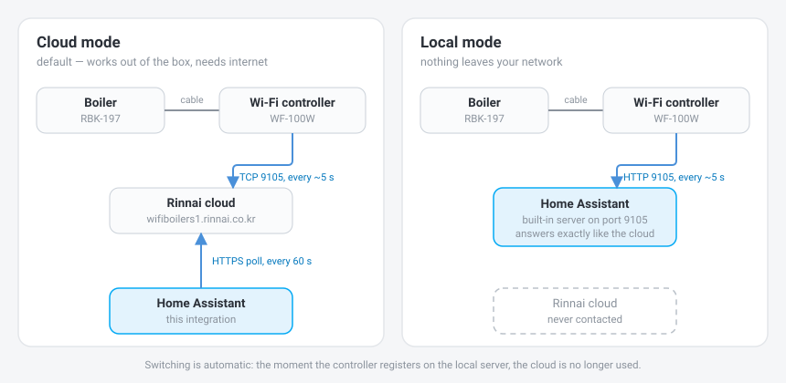

# Rinnai Boiler for Home Assistant

Home Assistant integration for Rinnai gas boilers that come with a **WF-100W / WF-S100** Wi-Fi room
controller (sold as *Rinnai Smart IoT* in Russia and Kazakhstan, *Rinnai Smart Boiler* in Korea).

It can talk to the Rinnai cloud the same way the phone app does — or replace the cloud entirely,
so the controller talks to Home Assistant and nothing leaves your network.

Tested on an **RBK-197 RTU** with a **WF-100W-RU** controller. [По-русски ниже](#по-русски).

## How it works

| Mode | What happens | Internet |
|---|---|---|
| **Cloud** | Home Assistant polls the Rinnai cloud with the same API the app uses | required |
| **Local** | The controller connects to a small server built into the integration instead of the cloud | not needed |

You don't pick a mode. As soon as the controller registers on the local server, the cloud is no
longer used. The `Source` sensor shows which one is active right now.

The boiler is a gas appliance, so the integration is deliberately conservative: it never rebuilds
the controller's status packet from parsed fields. It changes only the bytes it means to change
and echoes everything else back untouched. Fields we don't understand can't get corrupted.

## What you get

* `climate` — heating: room temperature, setpoint 10–40 °C, on/off
* `water_heater` — hot water: current temperature, setpoint 35–60 °C, on/off
* `number` — heating circuit water temperature, 20–80 °C
* `sensor` — room and hot water temperature, circuit setpoint, mode, burner state, error code, schedule, data source
* `binary_sensor` — fault, hot water flowing, controller offline
* `switch` — power, heating, hot water, circuit mode, away, economy, night

`climate` and `water_heater` pass through the HomeKit bridge, so the boiler shows up in Apple Home.

| Apple Home | Home Assistant |
|---|---|
|  |  |

## Install

1. Copy `custom_components/rinnai` into `config/custom_components/`, or add this repository to HACS
   as a custom repository.
2. Restart Home Assistant.
3. *Settings → Devices & services → Add integration → Rinnai*.
4. Fill in two fields:
   * **RoomControlId** — the controller's Wi-Fi MAC address as 12 hex characters, e.g. `a1b2c3d4e5f6`.
     Your router's client list will show it, usually under the name `Thermostat`.
   * **DeviceId** — the UUID of a phone that is already registered in the Rinnai app. The cloud
     rejects unknown ids, so it has to be a real one; grab it with any HTTPS sniffer
     (HTTP Catcher, Proxyman) from a request to `wifiboilers1.rinnai.co.kr`.

No password is stored — the cloud authenticates by these two headers alone.

## Going cloud-free

The controller resolves `wifiboilers1.rinnai.co.kr` and opens a connection to port **9105**.
Point that name at Home Assistant and it will talk to the built-in server instead.

1. Add a static DNS record on your router: `wifiboilers1.rinnai.co.kr` → *your Home Assistant IP*.
   Make sure it is the **only** record for that name.
2. Make the controller look the name up again. It caches the address in RAM, so dropping the
   connection isn't enough — restart the Wi-Fi access point or power-cycle the controller.
3. The `Source` sensor switches to *Local*.

While the controller is local, the official Rinnai app can't see the boiler. Heating itself doesn't
depend on any of this: the controller drives the boiler over a cable, with or without a server.

<b>Protocol notes</b>

Packets are ASCII: `<prefix:6><command:2><length:2><data><checksum:2>7d`. `length` counts hex
characters of `data`; the checksum is `sum(ord(c) for c in data) % 256`. The cloud HTTP API always
sends `00` instead of a real checksum — the controller doesn't, and rejects replies with a wrong one.

Controller endpoints (port 9105, plain HTTP):

* `POST /register` — `re0000` + MAC + product code. Reply: `re0100` + any 32-character token.
* `POST /state` — `re0101` + full status. The reply must echo the payload; to send a command,
  change the prefix to `sm0101` and patch the bytes you want.

Known status bytes: `0` flags (`0x01` power, `0x02` circuit mode, `0x04` heating, `0x08` hot water,
`0x10` preheat, `0x20` quick heat), `1` room setpoint, `2` circuit setpoint, `3` hot water setpoint,
`4` room temperature, `5` hot water temperature, `6` burner/flow status (`&0x0f` combustion,
`0x20` hot water flowing), `7–8` error code (`ffff` = none), `9` away. A temperature with bit
`0x80` set carries an extra half degree.

Cloud commands (`POST /control`): `01` flags, `02` room setpoint, `03` circuit setpoint,
`04` hot water setpoint, `05` away, `07` economy, `08` night.

## Credits

Protocol groundwork: [mog422/open-rinnai-server](https://github.com/mog422/open-rinnai-server)
and [zobithecat/rinnai-ha](https://github.com/zobithecat/rinnai-ha).

## Disclaimer

This software controls a gas appliance. It is not affiliated with or endorsed by Rinnai.
Use at your own risk.

## License

MIT

---

## По-русски

Интеграция газовых котлов Rinnai с Wi-Fi-пультом **WF-100W / WF-S100** («Смарт управление» / *Rinnai Smart IoT*)
в Home Assistant.

Работает двумя способами: через облако Rinnai — точно так же, как приложение на телефоне, —
или полностью без облака: пульт подключается к Home Assistant, и наружу не уходит ничего.

Проверено на **RBK-197 RTU** с пультом **WF-100W-RU**.

### Как это устроено

| Режим | Что происходит | Интернет |
|---|---|---|
| **Облако** | Home Assistant опрашивает облако Rinnai тем же API, что и приложение | нужен |
| **Локально** | Пульт подключается к маленькому серверу внутри интеграции вместо облака | не нужен |

Режим выбирать не надо: как только пульт зарегистрировался на локальном сервере, облако больше
не используется. Датчик «Источник» показывает, что активно сейчас.

Котёл — газовый прибор, поэтому интеграция осторожна: она никогда не собирает пакет состояния
заново из разобранных полей. Меняются только те байты, которые нужно поменять, всё остальное
возвращается пульту как есть. Непонятные нам поля испортить невозможно.

### Что появляется в Home Assistant

* `climate` — отопление: температура в доме, уставка 10–40 °C, вкл/выкл
* `water_heater` — горячая вода: текущая температура, уставка 35–60 °C, вкл/выкл
* `number` — температура теплоносителя, 20–80 °C
* `sensor` — температура в доме и ГВС, уставка контура, режим, состояние горелки, код ошибки, расписание, источник данных
* `binary_sensor` — авария, водоразбор, нет связи с пультом
* `switch` — питание, отопление, ГВС, режим по теплоносителю, отъезд, эконом, ночной

`climate` и `water_heater` проходят через мост HomeKit — котёл виден в Apple Home
(скриншоты выше).

### Установка

1. Скопируйте `custom_components/rinnai` в `config/custom_components/` или добавьте репозиторий
   в HACS как пользовательский.
2. Перезапустите Home Assistant.
3. *Настройки → Устройства и службы → Добавить интеграцию → Rinnai*.
4. Два поля:
   * **RoomControlId** — MAC-адрес Wi-Fi пульта, 12 hex-символов, например `a1b2c3d4e5f6`.
     Виден в списке клиентов роутера, обычно под именем `Thermostat`.
   * **DeviceId** — UUID телефона, уже зарегистрированного в приложении Rinnai. Облако отвергает
     незнакомые id, так что нужен настоящий; его видно в любом HTTPS-сниффере
     (HTTP Catcher, Proxyman) в запросе к `wifiboilers1.rinnai.co.kr`.

Пароль не хранится — облако авторизует только по этим двум заголовкам.

### Без облака

Пульт резолвит имя `wifiboilers1.rinnai.co.kr` и открывает соединение на порт **9105**.
Направьте это имя на Home Assistant — и пульт придёт на встроенный сервер.

1. Добавьте на роутере статическую DNS-запись: `wifiboilers1.rinnai.co.kr` → *IP Home Assistant*.
   Запись для этого имени должна быть **одна**.
2. Заставьте пульт заново разрешить имя. Адрес он кеширует в памяти, обрыв соединения не
   помогает — перезапустите точку доступа Wi-Fi или передёрните питание пульта.
3. Датчик «Источник» переключится на «Локально».

Пока пульт локальный, официальное приложение Rinnai котёл не видит. На само отопление это не
влияет: пульт управляет котлом по кабелю, с сервером или без.

### Ответственность

Это программа для управления газовым прибором. Проект не связан с Rinnai и не одобрен ею.
Используйте на свой риск. Лицензия — MIT.
